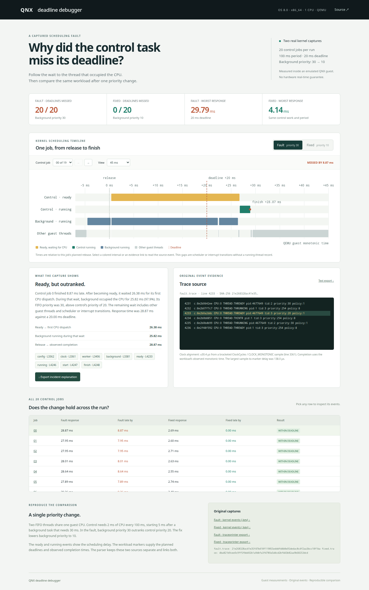

# QNX deadline debugger

Find the thread that kept a QNX control task waiting, read the original events,
and compare a second capture after changing its priority.



## Run the tool in under five minutes

Requires Python 3.10 or newer and a browser. No packages, account or QNX licence
are needed to inspect the included captures.

```sh
git clone https://github.com/adityareddy-dev/qnx-deadline-debugger.git
cd qnx-deadline-debugger
python3 -m deadline_debugger
```

Open **http://127.0.0.1:8765**. Select a control job, switch between Fault and
Fixed, then select an interval or evidence link to read the original trace line.
The incident export includes the explanation, source hash and events used in
the calculation. Stop the server with Ctrl+C.

The [demonstration](media/demo.mp4) runs for less than three minutes and shows
the actual tool, both captures and an incident export.

## What was measured

Two FIFO threads share one QNX guest CPU. Control needs 2 ms of CPU every
100 ms, with a 20 ms deadline and a 5 ms release offset. Background needs 30 ms
of CPU each period. Its priority changes from 30 to 10. Control stays at 20.
No workload time budget or deadline changes between the two modes.

| Control task, 20 jobs | Fault, background priority 30 | Fixed, background priority 10 |
| --- | ---: | ---: |
| Missed deadlines | 20 | 0 |
| Worst release-to-completion time | 29.795 ms | 4.145 ms |
| Mean release-to-completion time | 28.384 ms | 2.772 ms |
| Longest ready-to-first-dispatch wait | 26.723 ms | 0.164 ms |

For fault job 0, control waited 26.381 ms after becoming ready. Background ran
for 25.822 ms of that wait, or 97.9%. The other time belongs to other guest
threads and scheduler or interrupt transitions. The original events are linked
in the browser and included in the exported explanation.

A [repeat capture](captures/repeat/results.json), made by running
`scripts/capture.sh` in the same guest, also had 20 misses before the change and
zero after. Its worst control response was 29.945 ms before and 4.835 ms after.
Both original binary captures and text exports are included in
[captures/repeat/](captures/repeat/).

**These are QEMU guest measurements. They do not establish hardware real-time
guarantees.** All runs were recorded on November 5, 2026. The exact versions,
commands, configuration and SHA-256 hashes are in
[captures/manifest.json](captures/manifest.json).

## Where the explanation comes from

The QNX instrumented kernel records thread ready, running and blocking states.
Workload user event 100 records thread identities, priorities, planned release
times and deadlines, and observed start and finish times. The tool joins these
sources by process and thread ID.

The initial dispatch wait starts at the first `THREADY` event after the job’s
sleep and ends at its first `THRUNNING`. Background CPU occupancy is the sum of
its running intervals overlapping that wait. Running intervals end when the
thread leaves its running state or another thread starts running. Gaps between
these state records stay unattributed. This is initial dispatch wait, not total
ready time across every later preemption.

Response time and deadline misses use the workload’s monotonic clock samples.
To put planned releases on the kernel timeline, a monotonic clock sample is
bracketed by two `ClockCycles()` calls. The midpoint maps cycles to monotonic
nanoseconds using the frequency recorded in the trace header. Half the bracket
is the alignment uncertainty: ±30.4 µs in the fault and ±38.7 µs in the fixed
capture. Marker emission follows the observed time sample, so a running interval
can extend beyond the finish sample. The interface shows that distinction.

The reader accepts QNX 8.0 `traceprinter` exports in the exact format below and
the `DD1` workload markers in [workload/deadline.c](workload/deadline.c). It is
deliberately scoped to this two-thread, one-CPU experiment. It rejects incomplete
jobs, duplicate markers, missing clock references, gaps in buffer sequences,
out-of-order events, absent wide thread fields and inconsistent comparisons.
Buffer continuity and marker checks catch several kinds of incomplete input,
but they cannot prove that an arbitrary edited file is authentic. The original
`.kev` files and recorded hashes allow an independent export.

QNX already provides the
[System Profiler](https://www.qnx.com/developers/docs/8.0/com.qnx.doc.ide.userguide/topic/kernel_tracing_process.html)
for exploring traces. This tool adds a narrow, event-linked incident explanation
and a controlled comparison. It uses QNX’s existing capture tools.

## Rebuild the QNX workload and record new runs

This requires the free QNX Everywhere non-commercial licence, QNX SDP 8.0 and
the QEMU quick-start image. Installing the SDK and image is separate from the
five-minute host tool setup above.

Recorded environment:

- QNX SDP `8.0.0.00141T202311271501L`, `qcc -Vgcc_ntox86_64`, GCC 12.2.0.
- QNX OS 8.0.0, x86_64, instrumented `procnto-smp-instr` kernel,
  build `2026/06/05-16:26:03EDT`.
- `com.qnx.qnx800.quickstart.qemu`,
  `0.5.0.00050T202609021847L`, Build 50, image dated September 2, 2026.
- QEMU 10.2.1, TCG, `pc` machine, `max` CPU, one vCPU, 2048 MB RAM,
  IDE disk and virtio network. No KVM was available on the recording host.

Follow QNX’s
[QEMU image setup](https://www.qnx.com/developers/docs/qnxeverywhere/com.qnx.doc.target_images/topic/qsti_qemu/getting_started.html)
to install and unpack the image. Then, from this checkout:

```sh
. ~/qnx800/qnxsdp-env.sh
make
sh scripts/boot-qemu.sh ~/qnx800/images/qemu/qemu/output/disk-qemu
```

The launcher creates a writable overlay outside the repository and leaves the
downloaded base image unchanged. It exposes guest SSH only on localhost port
2228. The serial console appears in that terminal. Let startup finish before
recording. In headless mode, the bundled desktop reports that its screen is
unavailable. The console, network and trace tools still start.

Use the image’s documented
[local login](https://www.qnx.com/developers/docs/qnxeverywhere/com.qnx.doc.target_images/topic/qsti/interacting-with-the-system.html).
Copy the workload and capture script from a second host terminal:

```sh
scp -P 2228 build/deadline scripts/capture.sh qnxuser@127.0.0.1:
ssh -p 2228 qnxuser@127.0.0.1
```

In the guest session:

```sh
chmod +x deadline
sudo sh capture.sh "$PWD/deadline" "$PWD/capture-01"
exit
```

The script runs each mode under an eight-second wide-event capture, with a
one-second delay before starting the workload. Each mode runs 20 jobs. It saves
the logger output and checks both the workload and logger exit status. Use a new
capture directory for each recording. The workload checks for one CPU, an
instrumented kernel and the requested FIFO priorities.

Back on the host:

```sh
scp -r -P 2228 qnxuser@127.0.0.1:capture-01 ./capture-01
. ~/qnx800/qnxsdp-env.sh
for mode in fault fixed; do
    traceprinter -f "capture-01/$mode.kev" -o "capture-01/$mode.trace" \
        -p 'c:%c CPU:%C %Z:%z'
done
python3 -m deadline_debugger serve --fault capture-01/fault.trace \
    --fixed capture-01/fixed.trace
```

The original recordings used the same logger and workload commands from a root
serial session, with a localhost HTTP transfer to the host. The repeat used
the supplied capture script. No account password, licence key, QNX binary or
guest disk is included in this repository.

Capture references:
[tracelogger](https://www.qnx.com/developers/docs/8.0/com.qnx.doc.neutrino.utilities/topic/t/tracelogger.html),
[traceprinter](https://www.qnx.com/developers/docs/8.0/com.qnx.doc.neutrino.utilities/topic/t/traceprinter.html).
Thread, process and user events are retained. Kernel calls, interrupt events,
communication and system classes are filtered to keep the recording small.
Kernel interrupt threads still appear as thread-state records.

## Command-line export and tests

```sh
python3 -m deadline_debugger analyze captures/fault.trace -o fault.json
python3 -m deadline_debugger compare captures/fault.trace captures/fixed.trace -o comparison.json
python3 -m unittest discover -s tests -v
sha256sum -c captures/SHA256SUMS
```

The tests use the real captured events. Corrupted copies are used only to check
that incomplete or inconsistent input is rejected.

## License

Project source and captured experiment data use the [MIT license](LICENSE).
QNX software, tools and images are obtained separately through QNX Everywhere.
